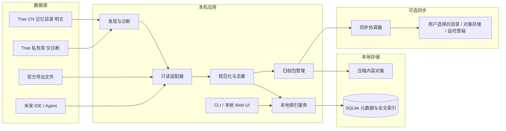

# Trae CN AI 会话归档与跨设备检索工具：项目构想

> 状态：构想稿（已按 2026-11-04 评审意见修订）
> 日期：2026-11-04
> 暂定项目名：Trae Archive（名称待定）

## 1. 项目摘要

Trae CN 用户在多台电脑间工作时，任务/会话历史可能无法同步；长期累积的 IDE 历史又可能占用大量磁盘。项目拟开发一个开源、本地优先的 AI 编程会话管理工具：从 Trae CN 等工具的本地数据中只读发现和导入会话，提供统一搜索、归档、导出和跨设备访问能力。

首个适配器面向 `%USERPROFILE%\.trae-cn\memory` 下的明文记忆目录，而不是 Trae 的加密私有数据库。该目录以项目、日期分层保存会话摘要与条目化记忆，无需解密、无需快照即可读取，已能支撑检索与续接两个核心场景。Trae 私有库经本机验证为加密且处于活动 WAL 状态，不纳入自动解析路线。

首版不修改 Trae CN 内部数据库，不承诺把归档记录恢复成 Trae 原生任务。跨设备续接先通过导出会话、复制摘要或生成项目交接文档完成。

本工具管理的是自己的副本，不改变 Trae 本体的磁盘占用。这一点在项目说明里需要写在显眼位置，避免用户误以为归档后 IDE 会变轻。

## 2. 问题与目标

### 用户问题

1. 电脑 A、B 上的 IDE 任务信息分散，换设备后难以查找和延续。
2. 历史会话长期增长，数据库和索引变大，IDE 加载变慢或失败。
3. 用户希望保留历史，但不希望所有历史都留在 IDE 的活动数据区。

第 2 条是本机可观测的事实：`%APPDATA%\Trae CN\ModularData\ai-agent\database.db` 已达 4.19 GiB，C 盘同期可用空间约 21 GB。但这个事实只解释痛点来源，不等于本工具能解决它。

### 产品目标

- 在用户设备本地发现、索引和搜索 AI 编程会话。
- 将历史数据以可迁移、可校验的格式归档。
- 支持用户选择同步归档和索引到另一台设备。
- 通过 Markdown/JSON 和项目上下文摘要帮助继续工作。
- 隐私默认本地；任何远端同步必须由用户显式启用。

### 非目标（首版）

- 不逆向破解加密，不提取或绕过密钥。
- 不直接对 Trae 数据库执行写入、删除、压缩或迁移。
- 不减少、不清理 Trae 私有数据库的占用，也不承诺让 IDE 加载变快。
- 不要求运行中心云服务；不强制用户注册账号。
- 不保证在 Trae UI 中恢复原任务、工具调用状态或附件。

## 3. 用户与核心场景

- **个人多设备开发者**：在 A 电脑结束工作，在 B 电脑搜索旧会话并带入摘要继续。
- **历史整理者**：按项目、日期和关键词查找旧任务，导出后将其移出常用工作集。
- **隐私敏感用户**：只使用本地功能，或自选同步位置，不把对话上传到默认服务。

典型流程：安装工具 → 扫描本机受支持的数据源 → 查看兼容性与数据量 → 导入只读副本 → 搜索/导出/归档 → 选择性同步规范化归档 → 在另一台设备检索并生成续接材料。

以上场景来自作者自身使用经验，尚无用户访谈或行为数据支撑。在拿到真实用户的检索失败案例之前，场景优先级属于假设，不宜据此锁定功能。

## 4. 方案比较与推荐

| 方案 | 优点 | 局限 | 结论 |
|---|---|---|---|
| 仅本地归档 | 结构简单、隐私边界清楚、易做 MVP | 跨设备需用户自行搬运归档 | 可作为第一阶段 |
| 本地优先 + 可选同步 | 同时解决检索和跨设备，用户可选存储端 | 需处理冲突、删除、鉴权和加密 | 推荐目标架构，分阶段实现 |
| 以明文记忆目录为首发源 | 无需解密与快照，自带项目与日期结构，可立即验证 | 记录的是摘要与条目，非完整对话原文；字段无公开规范 | 首版采用 |
| 直接同步/裁剪 IDE 私有数据库 | 看似能原生延续并减少源库体积 | 库为加密容器且处于活动 WAL，格式与版本均不可控 | 不纳入路线图 |

## 5. 推荐架构

```text
Trae CN 本地数据
  ├─ 明文记忆目录（首发）
  └─ 加密私有库（仅诊断，不读取内容）
       │ 只读适配器 / 官方导出导入
       ▼
规范化会话模型 ──► 本地元数据索引与全文检索
       │                         │
       ├──► Markdown / JSON / 项目交接摘要
       │
       └──► 可选加密归档包 ──► 用户选择的同步端 ──► 另一设备
```

### 组件职责

1. **数据源适配器**：识别安装版本和可能的数据目录；优先使用官方导出格式与明文记忆目录。未知或加密格式只报告状态，不尝试破解。适配器只读取源数据，且只打开自己在清单中声明的文件路径。
2. **规范化模型**：统一会话、消息、时间、项目标识、来源工具和附件引用等字段，同时保留来源版本与原始记录定位信息。
3. **本地索引库**：保存元数据、搜索索引和导入状态；会话正文可按需存储或引用归档包。索引可重建，不作为唯一原始副本。
4. **归档包**：按项目/时间组织会话，包含 manifest、数据文件、格式版本和校验和。支持导出、导入和完整性检查。
5. **同步层（后续阶段）**：同步不可变或内容寻址的归档对象和可合并元数据，不同步 Trae 正在使用的数据库文件。首选用户控制的文件存储/自托管端；远端加密策略单独设计。
6. **续接输出**：生成可审阅的 Markdown/JSON、上下文摘要和关键文件/决策列表，由用户带入新 Trae 任务。

## 6. 冷热数据策略

冷热分离只作用于本工具管理的数据。它不缩小 Trae 私有数据库，也不改变 IDE 的启动时间——归档完成后源库仍是原样。

- **热层**：近期会话、标题、摘要、必要消息片段和搜索索引，保存在本机，快速检索。
- **冷层**：较旧或已结束的完整会话放入压缩归档包；本地保留轻量元数据，需要时按需读取正文。
- **附件层**：附件独立去重和校验，避免把大文件重复塞入每个备份。
- **策略**：按时间、项目或容量给出归档建议；默认不删除源数据。源 IDE 数据只有在官方提供可靠归档/清理接口且用户明确操作时才可能治理。

## 7. 数据安全与可靠性原则

- 源数据只读；默认不上传任何内容。
- 扫描以白名单方式工作：适配器先声明要读取的文件路径集合，运行时实际打开的文件必须与声明一致。不做"遍历安装目录再过滤"，因为凭据与身份信息就存放在数据目录旁边（本机实测存在 `trae-jwt-token`，以及疑似账号标识的数字目录）。
- 扫描、导入、同步有清晰预览和状态；日志默认不记录会话正文、密钥或代码片段。
- 归档支持校验、重复检测和可恢复导入；删除同步设计墓碑/版本规则，避免一台设备误删后静默扩散。
- 对 SQLite 数据源，使用数据库支持的一致性快照方式；不在多设备间实时共享活动数据库文件。
- 若源格式无法可靠读取，明确降级为手动导入官方导出文件，不做未经验证的数据库修复。

冲突合并、重试与恢复的具体规则见 14.7 和 14.8，本节不重复。

## 8. MVP 范围

平台与数据源边界在此统一：首发仅支持 Windows + Trae CN，且只实现明文记忆目录一个适配器。

### MVP 0：可行性验证（已完成初判）

- 已确认数据目录：`%APPDATA%\Trae CN\ModularData\ai-agent\database.db`，4.19 GiB。
- 已确认该库为加密或私有容器格式（文件头非 SQLite 魔数），并处于活动 WAL 状态，另有 2026-10-15 的迁移残留文件。
- 已确认存在明文替代数据源：`%USERPROFILE%\.trae-cn\memory`，95 个文件、269.8 KB、10 个项目目录。
- 尚未确认：官方导出菜单在各产品线的有无与文件格式；记忆目录字段结构在不同版本间的稳定性。

结论与阶段门见 18.6。

### MVP 1：本地只读管理

- Windows；扫描并诊断支持的明文数据源，输出数据量、时间范围与字段覆盖情况。
- 导入规范化会话，按项目、日期、来源筛选和全文搜索。
- 导出 Markdown/JSON，生成项目交接摘要。
- 归档打包、校验、恢复演练；不修改原始 IDE 数据。
- 提供兼容性矩阵、数据路径说明和隐私说明。

### MVP 2：跨设备归档

- 支持将归档包放到用户选择的同步目录/存储端。（2026-11-06 决策：同步端形态定为「用户自选目录」，可指向 NAS/网盘挂载盘；归档包保持明文。）
- 增量传输、校验、重试、重复检测和冲突提示。
- 远端加密与密钥管理经过单独设计后再实现；不默认部署项目方云服务。（2026-11-06 决策：端到端加密推迟到 MVP 3 再定密钥管理；同步端必须支持完全本地/自托管，不默认写个人云盘，企业内容合规由用户自担。）

### 后续方向

- macOS/Linux；更多 IDE/Agent 的只读适配器。
- 可选桌面 UI、MCP/IDE 查询入口、语义搜索。
- 仅在官方 API 或充分验证的兼容方案存在时探索原生任务恢复或源库清理。

## 9. 风险与待验证事项

| 风险 | 影响 | 应对 |
|---|---|---|
| Trae 私有库加密（已确认，非风险） | 自动解析不成立 | 不进入路线图；仅保留诊断与手动导出回退 |
| 记忆目录字段随版本变化 | 解析失效或丢字段 | 适配器独立版本化；只依赖文件路径与最小字段集；变更时降级为原文导出 |
| 上游变更频率高于维护能力 | 适配器长期失修 | 支持版本白名单只增不追溯；版本过旧时提示手动导入并明确标注不再维护 |
| 项目路径/机器信息绑定 | 跨设备会话关联不准 | 统一项目标识优先用仓库远端与相对路径，原路径仅作本地元数据 |
| 大数据导入造成卡顿 | 体验差、内存高 | 流式处理、分批索引、后台任务、取消与断点续传 |
| 敏感内容意外外传 | 隐私/合规损害 | 本地默认、显式同步、传输前预览、可排除项目、可选加密 |
| 扫描误触凭据 | 凭据泄露 | 白名单读取，见 7 节 |
| 开源样本泄露对话/代码 | 用户数据泄漏 | 只提交合成样本，提供脱敏检查和贡献指南 |
| 归档被误认为会减少 Trae 原库 | 期待落差 | 项目说明直接写明不改变 IDE 占用，见 1、2、6 节 |

- `topics.md` 会话覆盖不完整：只有 topics 的会话无正文，只有 jsonl 的会话标题回退到 `intent`。UI 在空字段处显示“（无记录）”，不做补全猜测。
- 私有库体积持续增长且格式加密：`doctor` 只报告路径与体积，不读取内容；接入前需另立 ADR。

## 10. 成功指标

指标需要三个要素才能验收：数据规模、具体操作、阈值。本机记忆目录只有 269.8 KB、95 个文件，规模太小，不足以刻画性能，因此在 27.8 MB 量级（6706 个文件、5.4 万条记录）的合成集上建立了基线，实测值与测法见[压测报告](docs/压测报告-20261105.md)。下表的"阈值"包含 2026-11-05 的实测值，各项均已完成实测；其中归档与重建两项在 MVP 1 落地后以自动化测试实测，尚未在 27.8 MB 合成集上重跑，规模值待下次压测补录。

| 指标 | 规模与条件 | 操作 | 阈值 |
|---|---|---|---|
| 首次导入 | 27.8 MB 合成集，单机，空库 | 全量导入到 catalog.sqlite | 耗时 ≤ 101 s、峰值内存 ≤ 70 MB（实测 50.5 s、34.6 MB，回归允许 2 倍） |
| 索引体积 | 同上，导入完成 | 统计 catalog 及其 WAL 体积 | ≤ 源数据的 4 倍（实测 3.30 倍，trigram 分词） |
| 检索响应 | 27 MB 合成集，单机，索引已建好 | 输入关键词，等待首屏结果 | P95 ≤ 1 s（实测 LIKE 1.9 ms / FTS 1.6 ms） |
| 导入幂等 | 同一数据源连续导入两次 | 对比会话条数 | 第二次新增 0 条（实测 0） |
| 单条容错 | 样本中混入 1 条损坏记录 | 执行整批导入 | 其余记录全部导入，报告列出失败项（实测 48887/48888） |
| 源数据只读 | 任意一次扫描/导入 | 对比源目录文件时间与哈希 | 写入 0 次，哈希不变（实测 6706 个文件 0 变更） |
| 读取边界 | 任意一次扫描 | 记录实际打开的文件路径 | 集合等于适配器声明清单（实测 6696/6696，越界 0） |
| 归档可用 | 任一归档包 | 在另一设备导入并校验 | 校验通过，会话可检索（已测：`tests/test_archive.py` 导入往返 + `verify` 通过；合成集规模值待重跑） |
| 重建能力 | 删除索引后保留归档 | 从归档重建索引 | 会话数与正文一致（已测：`tests/test_acceptance.py` 从归档重建后导出逐字节一致；合成集规模值待重跑） |

指标之外的定性判断同样重要：如果工具只能做到"把自己的会话备份下来"，它的价值等同于文件复制。真正的价值在于跨项目、跨时间的检索质量，这一点需要在 MVP 验收时用真实查询验证，而不是只看上述表格是否达标。

## 11. 开源与发布建议

- 先发布可行性报告和数据源兼容矩阵，再发布 MVP。
- 采用适合个人/社区分发的开源许可证。（2026-11-06 决策：选 MIT——零运行时依赖、无第三方合规负担；LICENSE 文件随 MVP 2 启动批添加。）
- 仓库包含威胁模型、隐私说明、格式规范、备份恢复说明、支持版本列表和安全问题披露流程。
- 所有问题报告要求删除敏感数据库、真实对话、访问令牌后再提供日志或样本。
- 适配器与核心数据模型解耦，第三方可贡献其他工具的数据源适配器。

## 12. 参考资料与证据边界

- VS Code 已提供会话历史导出、搜索和可选账号同步，且明确区分历史同步与正在运行的会话；可借鉴其产品边界与隐私控制：[VS Code 会话历史同步](https://code.visualstudio.com/docs/agents/run/sessions/session-history)。
- ChatSync 展示了"本地解析器 + 统一索引 + 可选远端同步"的开源产品形态，但当前资料不能证明其支持 Trae CN：[ChatSync](https://marketplace.visualstudio.com/items?itemName=hurryingauto3.chatsync)。
- Trae 社区帖子提及 `ModularData/ai-agent/database.db` 等路径，本机探测已确认该路径存在，但文件格式未获官方说明：[Trae CN 社区迁移讨论](https://forum.trae.cn/t/topic/17964/20)。
- SQLite 官方文档说明 WAL 模式不支持跨主机通过网络文件系统共同访问数据库：[SQLite WAL](https://www.sqlite.org/wal.html)。在线备份 API 可生成一致快照：[SQLite Online Backup API](https://www.sqlite.org/backup.html)。
- 记忆目录的存在、结构与规模来自本机只读观测，属于未公开的内部格式，不构成官方接口承诺。

## 13. 立项时需要确认的问题

前三个问题已在本轮修订中给出建议答案，仅需确认；第四个无需复议。

1. 首发只支持 Windows + Trae CN，且只做明文记忆目录一个适配器。范围越窄，MVP 越可能真正跑通；扩大范围的成本主要落在长期维护上。
2. 首版不实现任何自动上传，只输出到用户指定的本地目录。这样"公司内容能否放个人云盘"在 MVP 阶段不成为前置决策，同步层等到确有人用再设计。
3. 成功标准采用"跨设备检索与摘要续接"，不要求原生恢复 Trae 任务。同时接受一条附加自检：如果检索质量无法明显优于文件备份，项目价值不成立。
4. 界面形态维持 CLI + 本地 Web UI。

## 14. 详细设计思路

### 14.1 产品原则

1. **源数据不可变**：所有接入器默认只读，导入操作写入本工具自己的存储区。
2. **本地先行**：不登录也可完成扫描、检索、导出和归档；同步是可选能力。
3. **格式开放**：规范化数据与归档包有公开版本规范，不把用户数据锁进服务端。
4. **适配器隔离**：每种 IDE 格式由独立适配器处理，核心层不依赖 Trae 私有字段。
5. **渐进式兼容**：不能解析就报告兼容状态并提供手动导入，不冒险猜格式。

### 14.2 逻辑架构



### 14.3 运行形态选择

首版采用单机本地服务 + CLI/本地 Web UI：核心能力作为本地进程运行，通过仅监听回环地址的 HTTP API 提供检索和归档接口；CLI 负责扫描、导入、导出和诊断，浏览器界面复用同一 API。这比一开始做原生桌面壳更易测试和跨平台，也避免先引入账号、云服务和复杂部署。

API 默认绑定 `127.0.0.1`，随机或受保护端口；配置写入用户数据目录。远程访问不默认开启。后续桌面 GUI 仅作为交互壳，不直接访问源 IDE 数据。

### 14.4 数据流

**首次扫描/导入**：发现器识别候选路径与应用版本 → 用户检查数据源和预计数据量 → 适配器按声明清单读取明文文件 → 流式解析 → 规范化 → 基于来源 ID 与内容指纹去重 → 事务写入元数据和索引 → 原始数据/附件进入内容对象存储 → 生成导入报告。

**增量更新**：记录源文件指纹、大小、修改时间和适配器版本；若源支持稳定游标，则只读取变更部分；否则重新扫描清单并按指纹幂等导入。索引损坏时可从归档对象重建。

**跨设备**：设备 A 打包新增的不可变对象及 manifest → 同步端校验并接收 → 设备 B 下载后校验 → 导入本地索引。同步对象与本机索引分离，不把 SQLite 活动库作为同步载荷。

**续接**：用户选定会话 → 工具生成摘要（目标、已完成、关键决策、文件、未完成事项）并附可选原文片段 → 用户审阅后复制到新任务或导出项目文档。

### 14.5 核心数据模型（概念级）

首版只需要四张表。多源登记、附件去重与同步状态表在对应能力真正开工时再加。

| 实体 | 关键字段 | 说明 |
|---|---|---|
| Project | project_id, display_name, repo_remote_hash, local_path_hint | 跨设备项目关联；仓库地址可本地脱敏保存，绝对路径仅作本机提示 |
| Session | session_id, project_id, source_kind, title, created_at, updated_at, content_hash, status | 规范化会话头信息 |
| Message | message_id, session_id, sequence, role, timestamp, body_ref, metadata_json | 消息顺序与内容引用；摘要类记录允许 body_ref 指向摘录文件 |
| ImportRun | run_id, adapter_version, started_at, result, warnings | 可审计导入过程，不记录正文 |

延后实体：Source（多源登记时）、Blob（附件去重时）、SyncObject（同步阶段）。

ID 使用稳定来源 ID。记忆目录的会话 ID 可直接从 `topics.md` 记录前缀与 `session_memory_*.jsonl` 文件名取得，无需推导，详见[字段结构报告](docs/适配器字段结构报告-trae-cn-memory.md)；其他来源没有 ID 时，才用路径与内容指纹生成并做碰撞检测。跨设备项目关联优先使用 Git remote 的规范化哈希，其次使用用户显式映射。

### 14.6 存储布局

```text
user-data/
  catalog.sqlite                        # 会话元数据、导入状态、全文索引
  objects/ab/cd/<hash>                  # 内容对象，按哈希去重
  archives/<project>/<date>-<id>.zip    # 内含 manifest.json 与数据文件
  temp/                                 # 可清理的临时导入文件
  config.toml                           # 本地配置，不含明文同步密钥
```

归档包使用标准 zip，根目录放 `manifest.json`，记录格式版本、生成时间、文件清单与每个文件的 sha256、来源适配器版本。自定义扩展名与压缩算法留到格式稳定后再引入：单适配器、单用户的阶段不值得为一套私有容器格式承担规范维护成本。

SQLite 仅服务本机索引，全文索引使用 FTS5；原始正文与附件按内容对象存储，避免每次查询都加载全部内容。索引可重建，归档对象才是本工具保留内容的持久副本。

### 14.7 同步一致性与冲突

- 归档对象不可变，以内容哈希寻址；传输可分块、断点续传、校验后原子落盘。
- 每设备维护单调递增的变更日志/manifest；元数据更新采用版本号和修改时间辅助合并。
- 会话正文默认不可变；若同一会话后续追加，生成新对象版本，保留旧版本直到策略清理。
- 删除先实现本地隐藏/归档状态；远端硬删除需显式确认并处理其他设备离线情况。
- 冲突不静默覆盖正文；保留双方并给出可读冲突记录。
- 云端同步若实现端到端加密，服务端只存密文对象与必要的同步元数据；密钥由用户管理，丢失密钥可能无法恢复数据。

### 14.8 错误处理与恢复

- 源路径不存在、权限不足、文件被占用、未知版本、加密格式、解析异常分别给出诊断码和建议。
- 单会话解析失败不阻断整次导入；报告成功、跳过和失败数，并允许重试失败项。
- 导入采用批次事务，未完成批次可回滚本工具写入，不触碰源数据。
- 归档导出先写临时文件，完成校验后原子改名；磁盘空间不足时停止并保留可恢复状态。
- 数据库迁移前备份本工具自身 catalog；索引可重建，归档对象不应被迁移脚本删除。
- 同步失败使用退避重试并显示最后成功时间；错误信息避免包含会话正文、访问令牌或敏感路径。

### 14.9 性能与规模目标

- 扫描和解析流式进行，不将全部会话一次性载入内存。
- 导入支持暂停、取消、断点续传和后台运行。
- 性能阈值与测量方法见 10 节。当前本机样本只有 269.8 KB，必须在 27 MB 量级的合成集上压测后才能确认阈值，之前不对外承诺具体数字。
- 对象按需解压，索引只保存必要字段和正文检索索引。
- 提供存储占用统计：源数据估算、本地索引、归档对象、附件、待同步量分项显示。

## 15. 技术栈决策（暂定）

首版优先选择成熟、易分发并支持可靠 SQLite 只读访问的技术栈；语言与 UI 框架在 MVP 0 后按团队熟悉度确定。关键技术决策应满足：Windows 路径与权限处理可靠、SQLite FTS 可用、流式大文件处理、可构建 CLI、后续可复用本地 API。避免在格式可行性尚未确认前锁定重型云端或桌面框架。

## 16. 架构决策记录

- **ADR-001：不直接同步活动数据库**。选择同步归档对象和 manifest，原因是活动 SQLite/WAL 文件不适合作为跨主机共享数据文件。
- **ADR-002：源适配器只读**。首版不承担修改 IDE 私有数据导致用户历史丢失的风险。
- **ADR-003：本地优先、同步可插拔**。核心离线可用，同步端通过接口替换，避免绑定单一云厂商。
- **ADR-004：归档正文与搜索索引分离**。正文对象持久保存，索引可重建；减少常驻热数据并方便后续迁移。
- **ADR-005：不承诺原生任务恢复**。先提供可移植的检索和上下文交接，除非未来出现稳定官方接口。
- **ADR-006：首发适配器选明文记忆目录**。私有库已实测为加密容器且处于活动 WAL，自动解析不成立；记忆目录无需解密与快照，能覆盖检索与续接两个场景，代价是只含摘要与条目而非完整原文。完整决策见 [ADR-006](docs/adr/ADR-006-首发适配器选用明文记忆目录.md)。
- **ADR-007：归档包用标准 zip + manifest.json**。单适配器阶段不引入私有容器格式，降低规范与兼容维护成本。完整决策见 [ADR-007](docs/adr/ADR-007-归档包采用标准zip加manifest.md)。

## 17. 设计阶段的验证清单

- [x] 记录本机 Trae CN 数据目录、库大小与格式特征（仅读元数据与文件头，未读正文）。
- [x] 判定私有库可读性：非明文 SQLite，处于活动 WAL，存在迁移残留文件，不支持自动解析。
- [x] 确认明文替代源：`%USERPROFILE%\.trae-cn\memory`，95 个文件、269.8 KB、10 个项目目录。
- [x] 抽样确认记忆目录字段结构：六个基础字段稳定，第七字段按摘要方式条件出现，会话 ID 可直接取用。详见[字段结构报告](docs/适配器字段结构报告-trae-cn-memory.md)。
- [x] 在 Trae 与 SOLO 上确认目录编码：编码规则共用，SOLO 无可读源，详见兼容性矩阵初表。
- [x] 记录产品版本：TRAE 3.6.4、TRAE CN 3.4.14；SOLO 无安装记录，版本未确认。
- [x] 抽样 Trae（国际版）jsonl：字段与 Trae CN 同构，但样本仅 1 条，需扩样后才能进白名单。
- [x] 在界面内确认 Export Chat 菜单的有无与导出格式（2026-11-06 人工确认：有导出入口，格式为 Markdown；另有分享链接，内容上官方云端，不纳入导入通道；内容覆盖未验证）。
- [x] 用 27 MB 量级合成数据验证流式解析、去重和中断恢复。实测结论见[压测报告](docs/压测报告-20261105.md)：只读、幂等、容错、读取边界四项达标；归档与重建两项已在 D3 实现后补测（2026-11-05），见下方实现验证与第 10 节表格。
- [x] 明确同步目标存储与远端加密方案（2026-11-06 决策：MVP 2 做用户自选目录同步端，归档包保持明文；端到端加密推迟 MVP 3，见第 11 节）。
- [x] 确认企业设备内容的同步政策、许可证和依赖合规要求（2026-11-06 决策：同步端必须支持完全本地/自托管、不默认写个人云盘；许可证 MIT，见第 11 节）。

实现验证（2026-11-05）：MVP 1 落地后，与设计约束相关的五项验收已在 `tests/test_acceptance.py`、`tests/test_archive.py` 与真实数据链路上复验通过，数据源限定为 `.trae-cn/memory` 白名单文件（`topics.md`、`session_memory_*.jsonl`、各项目 `project_memory.md`、根 `user_profile.md`），私有库与 SOLO 不在读取范围。

- 只读哈希不变：导入前后对源目录逐文件比对 SHA-256，写入 0 次、哈希全等（`test_import_never_modifies_source_tree`）。
- `--audit` 无越界：`import --audit` 用 `sys.addaudithook` 记录本次实际打开的文件，实际集合越出声明清单即失败退出（审计在导入结束时统一判定，属事后审计，钩内即时拦截留待后续）；真实数据实测打开 14 个文件，越界 0。
- 强杀后续跑行数一致：导入中途 `os._exit(9)` 杀掉进程后重跑，消息行数与逐文件完成标记均与不中断导入一致（`test_hard_kill_then_resume_completes`）。
- 归档篡改被拒绝：改动正文哈希、删除 manifest、增删条目、路径穿越均被 `verify` 拒绝，`import --archive` 对篡改包直接失败（`test_import_refuses_tampered_archive` 等）。
- 检索 P95 实测值：对本机真实语料（5 项目 / 9 会话 / 47 消息，trigram 分词）连续 30 次 `catalog.search_messages` 调用，P95 为 0.6 ms、最大 3.2 ms；语料仅 47 条消息，该值只说明链路无异常开销，不代表规模性能，规模性能以第 10 节 27.8 MB 合成集基线（FTS 1.6 ms）为准。

## 18. MVP 技术规格（已选：CLI + 本地 Web UI）

### 18.1 MVP 边界

MVP 聚焦单机完整可用：诊断数据源 → 导入本地目录 → 搜索/浏览 → 导出与生成续接摘要。数据源限定为明文记忆目录；跨设备先通过用户复制归档包完成；自动云同步、账号体系、原生任务恢复、源数据库清理和 AI 自动总结均不作为首个可用版本的依赖。摘要首版用确定性模板提取标题、用户目标、末尾对话和显式文件路径；后续再评估模型总结。

### 18.2 运行架构

- 一个本地后台进程负责发现、导入、索引、导出和 HTTP API。
- CLI 是可脚本化入口；本地 Web UI 是浏览和搜索界面，共用 API 与业务服务。
- 服务仅绑定 `127.0.0.1`，首次运行使用动态端口；启动时生成一次性会话令牌，UI 通过本地启动链接取得访问权。
- 浏览器 UI 不能直接读取源目录；所有文件访问由后台服务完成。
- 关闭服务不影响源 IDE；强制终止后可通过导入批次状态恢复或重跑。

### 18.3 最小命令与界面

| 命令/页面 | 职责 |
|---|---|
| `doctor` | 显示系统、应用版本、候选路径、读权限、文件大小、格式识别状态；默认不读取正文 |
| `scan` | 枚举会话数量和时间范围，输出导入预览；不写入源目录 |
| `import` | 用户确认后导入到本工具数据目录，可指定来源/会话范围 |
| `serve` | 启动本地 API 与 Web UI |
| `export` | 输出选中会话或项目的 Markdown/JSON/归档包 |
| `verify` | 检查归档 manifest、哈希和索引完整性 |
| Web：会话列表 | 按项目、来源、日期筛选，显示导入状态和大小 |
| Web：会话详情 | 按顺序阅读消息，复制摘要、导出 Markdown |
| Web：存储诊断 | 区分源库估算、索引、归档、附件与临时空间 |

### 18.4 MVP 数据与接口边界

适配器对核心层只暴露 `detect()`、`inspect()`、`enumerate()`、`read_file()` 等只读接口，并额外暴露 `declared_paths()`，返回本次操作将要打开的文件清单。核心层在调用读取前比对该清单与实际路径，不一致即中止并报诊断码。

核心层负责规范化、去重、对象写入、索引和报告；UI/CLI 不直接调用适配器内部实现。导入任务以 `ImportRun` 为单位，可查询进度、取消和重试。

对加密、未知格式或无法安全快照的数据源，`doctor` 与 `scan` 返回明确状态及官方导出回退步骤；不得尝试猜密钥、修改数据库或在 IDE 运行期间直接复制活动数据库文件。官方导出文件仍作为备用导入来源。

### 18.5 MVP 验收标准

- 用户能看见检测出的数据源、版本、预计会话数和可读性结论，再决定是否导入。
- 导入过程不会对源目录产生写操作；同一数据重复导入不会产生重复会话。
- 任意单条记录解析失败时，其余可解析记录仍能导入，报告提供失败原因分类。
- 关键词搜索、项目/日期筛选、会话阅读、Markdown/JSON 导出可离线完成。
- 扫描过程中实际打开的文件路径集合等于适配器声明的清单，凭据类文件不在其中。
- 导出的归档包可校验并在另一台设备导入；此处的跨设备操作可为手动复制文件。
- 服务默认仅本机可访问；停止服务后，源 IDE 正常使用。
- 索引可从保留的规范化数据/归档对象重建；不以修改或缩小 Trae 数据库作为验收条件。

### 18.6 可行性验证阶段门（结论：私有库不通过）

原计划在进入自动解析实现前完成五项验证。第一、三项已完成初判，结论如下。

| 阶段门 | 状态 | 结论 |
|---|---|---|
| 记录产品名、版本、系统、数据目录 | 已完成（本机） | `%APPDATA%\Trae CN\ModularData\ai-agent\database.db` 成立，4,496,863,232 字节 |
| 寻找官方导出能力 | 未完成 | 仍需用户在其产品线确认菜单是否存在、导出何种格式 |
| 判断库格式与快照可行性 | 已完成初判 | 文件头为 `ef 89 24 dd…`，非 `SQLite format 3`，判为加密或私有容器；`database.db-wal` 8.6 MB 且正在写入；另有 `database.db.new-20261015` 等迁移残留与一份带水位线的项目域迁移记录 |
| 形成兼容性报告 | 部分完成 | 私有库：不支持自动读取。记忆目录：可读，字段结构待验证 |
| 白名单准入 | 已有结论 | 私有库不进入白名单；记忆目录在字段抽样验证后进入 |

由此确定的结论是：私有库自动解析不进入实现路线。加密格式叠加活动 WAL 与版本迁移，使"读得对"和"读得稳"两个条件都无法保证，而绕过加密不在产品原则内。此前的"待验证风险"相应改记为已确认约束。

阶段门关闭后，验证工作转向两件仍具不确定性的事：记忆目录字段结构在不同版本间的稳定性，以及官方导出菜单的存在性与文件格式。这两项完成前，记忆目录适配器标记为实验性支持，兼容矩阵中写明已验证版本。

## 19. 变更记录

- 2026-11-04：初稿，确定首版交互采用 CLI + 本地 Web UI；MVP 先实现本地诊断、导入、检索和导出，跨设备通过归档文件手动搬运，自动同步后置。
- 2026-11-04：根据公开资料更新可行性结论；导入策略改为官方导出优先，私有数据库读取仅针对已验证版本白名单开放。
- 2026-11-04：按评审意见修订。本机只读探测确认私有库为加密容器且处于活动 WAL，自动解析路线关闭，18.6 阶段门结论由"待验证"改为"不通过"；新增明文记忆目录为首发适配器（ADR-006）；删除归档可减轻 IDE 负担的表述；成功指标改为规模、操作、阈值三要素；新增扫描白名单与读取边界验收；数据模型精简为四张表；归档包改为 zip + manifest（ADR-007）；同步层与详细错误处理合并去重；新增维护成本与版本放弃策略。
- 2026-11-04：完成记忆目录字段结构抽样，输出[字段结构报告](docs/适配器字段结构报告-trae-cn-memory.md)。据此修正 ADR-006：`topics.md` 改为按行记录格式，会话 ID 直接取自源内标识，新增项目目录归并约束；14.5 与 17 节同步更新。
- 2026-11-04：探测三个产品线的数据布局，新增 20.6 兼容性矩阵初表。确认路径编码规则共用，SOLO 无可读源，仅诊断；产品版本号与导出菜单仍待填。
- 2026-11-04：补齐矩阵版本列（TRAE 3.6.4、TRAE CN 3.4.14，SOLO 无安装记录），抽样 Trae（国际版）jsonl 确认与 Trae CN 同构。矩阵改为按安装版本判定，排除 product.json 中两产品共用的壳版本号。
- 2026-11-05：完成 27.8 MB 合成集压测，输出[压测报告](docs/压测报告-20261105.md)。第 10 节由"待建立基线"改为带实测值的阈值，新增首次导入与索引体积两项；第 17 节对应检查项勾选。压测同时暴露三条实现约束：按文件提交导致 6696 次事务（吞吐仅 0.55 MB/s）、trigram 索引体积为源数据 3.3 倍、原型白名单漏掉 `project_memory.md`。
- 2026-11-05：MVP 1 实现完成，六个子命令可用；归档格式 `sessionpack-archive` v1。
- 2026-11-06：MVP 1.2 遗留项收口：归档失败文本净化绝对路径、会话导出补 `charset=utf-8`；新增 B3 最小口径覆盖扫描脚本与「哪些历史搜不到」边界说明；20.6 矩阵「支持字段」列补样本范围注（F2）；清单 ②④⑥⑳/E2 关闭、B2/B3 收口标注（见《未完成任务清单》）。
- 2026-11-06：落档 A1/A2 界面确认与 C1/C2 决策。A1：TRAE/TRAE CN 存在导出入口，格式 Markdown（.md），内容覆盖待补测，官方分享链接上传官方云端、不纳入导入通道；A2：SOLO CN 已卸载，矩阵记「不再维护」；C1：MVP 2 同步端定为用户自选目录、归档包保持明文、端到端加密推迟 MVP 3（第 8 节）；C2：同步端必须支持完全本地/自托管、许可证选 MIT（第 8、11 节）。20.2、20.5、20.6 同步更新。
- 2026-11-10：B1 官方导出内容覆盖验证完成（样本 `spike/分析并确定下一步计划.md`，1.09 MB / 17 轮）。结论：导出为单会话，格式「`# 标题` + `> Workspace` + `**User**`/`**Assistant**` 交替」，含完整对话原文（用户提问 + AI 完整回答/思考）；**无结构化工具调用块、无二进制附件**（附件仅 `file:///` 文本路径链接；**含图片的对话中图片被丢弃、仅保留文字**）。分享链接为网页形式，**含图片**（浏览器可见，经 JS 从后端 API + CDN 动态加载，静态 HTML 无图片引用，程序化抓取需 headless 浏览器）与工具摘要行。另新增 ADR-008（内置数据库逆向与冷热分离作为未来方向，当前采用只读归档 + 官方导出导入），并落地「官方 Markdown 导入适配器」（`import --export-dir`，角色入 `meta_json.role`）。
- 2026-11-10：`search` 命令扩展会话级检索：新增 `catalog.search_sessions`（标题/摘要 LIKE、墓碑隐身），`run_search` 同时报消息命中与会话命中，JSON 增 `session_hits` 字段（保留 `hits` 兼容）；填补"只记得标题词、消息 FTS 无果"的检索缺口。

## 20. 公开资料可行性调研

### 20.1 当前证据

| 议题 | 观察 | 对项目的影响 | 证据强度 |
|---|---|---|---|
| Trae CN 本地数据位置 | 社区回复提及 `%APPDATA%\Trae CN\ModularData\ai-agent\database.db` | 该路径在本机成立，可作为诊断候选；不硬编码为所有版本通用路径 | 本机实测已确认 |
| 数据库格式 | 库 4.19 GiB，文件头非 SQLite 魔数；WAL 8.6 MB 活动写入；存在 2026-10-15 迁移残留 | 自动解析不成立，首发不投入；仅报告诊断状态 | 本机实测已确认 |
| 明文数据源 | `%USERPROFILE%\.trae-cn\memory` 下 95 个文件、269.8 KB，按 `projects/<项目编码>/<日期>/` 组织，含 `topics.md`、`session_memory_*.jsonl`、`user_profile.md` | 可作为首个适配器，覆盖检索与续接场景；内容为摘要与条目而非原文。字段结构已抽样确认，见[字段结构报告](docs/适配器字段结构报告-trae-cn-memory.md) | 本机实测已确认 |
| 数据目录相邻的敏感文件 | `trae-jwt-token` 与疑似账号标识目录位于同一父目录 | 扫描必须白名单化，不能遍历后过滤 | 本机实测已确认 |
| 导出能力 | 社区反馈称部分版本可单条导出；TRAE Work 支持人员回复其不支持导出 | 必须按产品线、版本区分；保留手动导出作为备用来源 | 社区反馈，可能随版本变化 |
| 官方文档上下文能力 | TRAE 文档介绍 `@Past Chats`，可将当前项目历史对话作为上下文 | 已有项目内历史引用，但不能据此推断存在批量导出或跨设备同步 | 官方文档 |
| SQLite 快照 | Online Backup API 可生成一致快照；WAL 不支持跨主机网络文件共享 | 若未来接入明文 SQLite 源，必须用 API 取快照；禁止网盘共享源库 | 官方文档 |
| 同类产品 | VS Code Copilot 提供会话搜索、导出及可选云同步；ChatSync 采用本地解析 + 可选云同步 | 支持"本地索引与同步层独立于 IDE 私有库"的方向 | 官方产品文档/第三方项目说明 |

### 20.2 首发导入策略

策略由三层缩减为两层，第三层（私有库只读适配器）移出路线图。

1. **明文记忆目录**：首发适配器。读取 `projects/<项目编码>/<日期>/` 下的 `topics.md` 与 `session_memory_*.jsonl`，按项目与日期建立会话。适配器只依赖目录层级和少量稳定字段，不解析模型生成的自由文本结构。
2. **官方导出文件**：备用来源。2026-11-06 界面确认：存在导出入口，格式为 Markdown（.md）；内容覆盖（工具调用、附件引用、会话范围）未验证，接入前需补测。官方另有分享链接功能，会把内容上传官方云端，与本工具「数据不出本机」原则相悖，不纳入导入通道。

关于记忆目录的能力边界，需要在使用说明里明确写出：它保存的是模型提炼后的记忆与摘要，不是完整对话；字段结构属于内部格式，没有公开规范；不同产品线的目录编码规则不同。因此它适合做检索与续接，不适合作为完整归档的唯一来源。用户需要完整原文时，仍需官方导出。

自动发现路径只做诊断提示；默认不访问私有库内容。不得通过进程内存取密钥、逆向密钥派生或修改应用数据库来实现兼容。

### 20.3 兼容性矩阵与维护约定

每个数据源适配器发布兼容矩阵，至少记录：产品名称/版本、操作系统、来源格式、读取方式、支持字段、已知缺失字段、验证样本类型、最近验证日期。版本未知时降级为手动导入，不因文件名相似就假设兼容。

维护约定同样需要写进仓库：支持版本白名单只增不追溯，某个版本停止验证后在兼容矩阵中标注"不再维护"，并提示用户改为手动导入。单人维护的项目若不设这条线，会在上游频繁发版时被拖垮，而这个项目的主要失败风险来自维护而非技术。

### 20.4 公开资料来源

- [TRAE 官方文档：通过 @ 符号引用上下文](https://docs.trae.cn/ide_number-sign)：说明 `@Past Chats` 可引用当前项目历史对话；不代表提供批量导出。
- [TRAE 官方社区：任务/对话记录如何迁移](https://forum.trae.cn/t/topic/17964/20)：社区回复涉及数据目录和加密库，需视为线索而非稳定接口承诺。
- [TRAE 官方社区：更新后历史迁移问题](https://forum.trae.cn/t/topic/183133)：用户案例描述旧版/新版数据目录与迁移限制，不能推广为所有版本结论。
- [TRAE 官方社区：会话列表导出/导入建议](https://forum.trae.cn/t/topic/17739)：用户反馈部分版本可逐条导出，需求仍包括批量导出与导入。
- [TRAE 官方社区：TRAE Work 导出反馈](https://forum.trae.cn/t/topic/76063)：社区支持回复称 TRAE Work 当时不支持导出，说明不同产品线能力有差异。
- [SQLite WAL 文档](https://www.sqlite.org/wal.html)：说明 WAL 的跨主机网络文件系统限制。
- [SQLite Online Backup API](https://www.sqlite.org/backup.html)：说明一致性快照机制。
- [VS Code 会话历史同步](https://code.visualstudio.com/docs/agents/run/sessions/session-history)：会话搜索、导出与可选同步的产品参考。

### 20.5 结论与下一验证动作

结论：项目可行，但可行路径与初稿不同。私有库读取不再是"待验证的增强"，而是已关闭的选项；产品价值改由明文记忆目录承载，通过统一索引、归档和摘要续接实现。

下一项验证：字段抽样已完成，结论记入[字段结构报告](docs/适配器字段结构报告-trae-cn-memory.md)。抽样得到三条会影响实现的事实，已回填到 ADR-006 的实施约束：`topics.md` 是按行记录而非 Markdown，格式可用单条正则完整匹配；`session_memory_*.jsonl` 的六个基础字段稳定，第七字段按摘要方式条件出现，必须按可选处理；两类文件共用 24 位会话 ID，但只有 31 个会话同时具备摘要与记忆条目，另有 4 个仅见摘要、21 个仅见记忆条目。此外，同一仓库存在带与不带 `--pN-<hash>` 后缀的两个项目目录，适配器需要归并。

剩余验证：在界面内确认 Export Chat 菜单的有无与导出格式（2026-11-06 已完成：有导出入口，格式 Markdown，另有分享链接，见 20.6）；把 Trae（国际版）的 jsonl 样本从一个文件扩到全部，确认与 Trae CN 的全量一致。后者完成后即可锁定首个适配器的支持范围。

### 20.6 兼容性矩阵初表

本机实测三个产品线，结论如下。导出菜单已于 2026-11-06 界面确认（见下方说明），其余为实测值。

| 产品 | 版本 | 数据目录 | 私有库 | 明文记忆目录 | 读取方式 | 支持字段 | 状态 |
|---|---|---|---|---|---|---|---|
| Trae CN | 3.4.14 | `%APPDATA%\Trae CN` | 4.19 GiB，加密容器，WAL 活动 | 有，10 项目 / 60 jsonl / 25 topics | 记忆目录只读 | 六个基础字段已抽样确认 | 验证中 |
| Trae | 3.6.4 | `%APPDATA%\Trae` | 830 MB，加密容器 | 有，1 项目 / 1 jsonl / 0 topics | 记忆目录只读 | 已抽样，与 Trae CN 同构（样本 1 条） | 实验性 |
| TRAE SOLO CN | 已卸载（2026-11-06 用户确认） | `%APPDATA%\TRAE SOLO CN` | 2.9 MB，加密容器 | 无，`work-mode-projects` 仅空目录与一份标记文件 | 不支持 | 无 | 不再维护 |

版本号取自卸载注册表 `DisplayVersion`。`resources\app\product.json` 中的 `1.107.1` 是两个产品线共用的底层壳版本，不能用于兼容性判定，矩阵一律记录安装版本。SOLO CN 无安装记录也无安装目录，仅遗留 AppData；2026-11-06 用户确认已卸载、不再维护。

三点说明：

1. 路径编码规则由同一组件产生。两个有记忆目录的产品线对同一仓库生成了完全相同的目录名（`-<盘符>-<路径段>`，部分追加 `--pN-<16 位哈希>`），适配器只需实现一次编码解析。
2. SOLO 的全部会话数据都在加密库内，没有可读替代源，因此列进诊断范围而不做适配。这一条与 18.6 的结论一致：私有库不解析。
3. 记忆目录存在不等于有数据。Trae 的记忆目录仅 1 个项目、1 个 jsonl、无 `topics.md`，适配器必须允许 topics 缺失，此时标题从 `intent` 回退生成。

导出菜单已于 2026-11-06 界面确认、2026-11-10 内容覆盖验证（B1）：TRAE/TRAE CN 存在导出入口，导出格式为 Markdown（.md），单会话范围、含完整对话原文；无结构化工具调用块、无二进制附件（附件仅 `file:///` 文本路径链接）。官方另有分享链接功能，会把内容上传官方云端，与本工具「数据不出本机」原则相悖，不纳入导入通道。矩阵状态列的"验证中""实验性"均指记忆目录读取路径的验证状态，与导出无关；SOLO 记"不再维护"。维护约定依 20.3：版本停止验证后标注"不再维护"，不追溯旧版本。

> 注：「支持字段」列是样本范围内结论（2026-11-05 抽样，见《适配器字段结构报告》第 3.3 节样本范围声明与《使用说明-本地只读》「哪些历史搜不到」节），不构成跨版本承诺，最近验证日期 2026-11-05（本节注释更新于 2026-11-06）。
